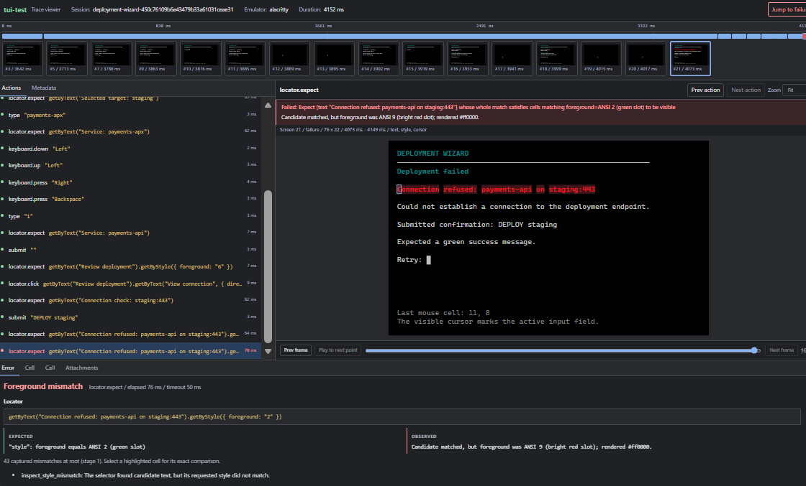

<div align="center">

# NASDUCK

**Memecoin economy layer for GTA VI.**
Launch, discover, search, buy, sell and trade tokens from the in-game market terminal — without ever leaving the game.


[Website](https://nasduck.org/) · [Install](#installation) · [Link PSN](#linking-a-playstation-network-account) · [How it works](#how-it-works) · [CLI reference](#market-terminal-reference) · [FAQ](#faq)


</div>

---

## Contents

- [What NASDUCK is](#what-nasduck-is)
- [The problem](#the-problem)
- [How it works](#how-it-works)
- [Requirements](#requirements)
- [Installation](#installation)
- [Linking a PlayStation Network account](#linking-a-playstation-network-account)
- [Quick start](#quick-start)
- [Market terminal reference](#market-terminal-reference)
- [Configuration](#configuration)
- [Recording, monitoring and traces](#recording-monitoring-and-traces)
- [Bindings](#bindings)
- [Exit codes](#exit-codes)
- [Security model](#security-model)
- [FAQ](#faq)
- [Roadmap](#roadmap)
- [Disclaimer](#disclaimer)
- [Contributing](#contributing)

---


## What NASDUCK is

NASDUCK brings a full memecoin economy into GTA VI. Players open the in-game market terminal, browse what launched in the last hour, search a ticker, read a book, buy, sell, take profit — and never touch a second screen.

The market is not a companion app. It is a surface inside the game, and NASDUCK is the engine that drives it: it attaches to the terminal session, mirrors every cell of the screen, routes orders, settles balances, and exposes the whole thing to scripts, bots and desktop tools through one Rust core and four language bindings.

Two halves, one product:

| Half | What it is |
| --- | --- |
| **Surface** | The in-game market terminal — the native screen where players launch and trade. |
| **Engine** | `nasduck` — the Rust runtime that attaches to the surface, resolves identity, routes orders, records and replays sessions, and exposes a stable API. |

You can drive the surface by hand in-game, or drive it from the CLI, or from Python, JavaScript, Rust and Go. It is the same engine and the same session either way.

## The problem

Every memecoin venue built for a game so far has made the same mistake: it asked players to leave the game.

Tab out, open a browser, connect a wallet, paste a contract, wait for a page to load, alt-tab back into a firefight. By the time you are back the launch is over. The economy exists, but it lives outside the thing it is supposed to be an economy *of*.

NASDUCK inverts that. The venue is a screen in the game. Discovery, search, price, book depth, position, exit — all of it is rendered by the game itself, in the game's own art direction, one button away from whatever the player was already doing.

That constraint is also what makes the engine interesting: to put a live market inside a terminal surface you need deterministic screen reads, retrying locators, snapshot assertions, structured failure traces and a recording format. Which is exactly what `nasduck` is.


## How it works

Four layers, each independently testable.

```
┌──────────────────────────────────────────────────────────────┐
│  4. SETTLEMENT                                               │
│     order router · matching · balance ledger · token supply   │
├──────────────────────────────────────────────────────────────┤
│  3. IDENTITY                                                  │
│     PSN link · per-session order key · entitlements           │
├──────────────────────────────────────────────────────────────┤
│  2. TRANSPORT                                                 │
│     local bridge · cell grid · backend (alacritty/ghostty/    │
│     rio/xterm.js) · PTY or LAN attach                         │
├──────────────────────────────────────────────────────────────┤
│  1. SURFACE                                                   │
│     in-game market terminal · launch · book · positions       │
└──────────────────────────────────────────────────────────────┘
```

**1. Surface.** The market terminal is a real text-mode application rendered by the game. Because it is a cell grid and not a bitmap, every element — ticker, price, depth, size, button — is addressable. NASDUCK reads the grid, not pixels, so a reshade or a resolution change does not break anything.

**2. Transport.** A local bridge publishes the terminal as a session. The engine attaches to it with the configured backend and gets a normal session handle: rows, columns, cells, styles, cursor, title, scrollback. From that point the surface is indistinguishable from a shell.

**3. Identity.** The terminal only serves a player it can name. Linking a PSN account binds the session to your identity, resolves your in-game wallet and derives a per-session order key. Orders are signed locally; the key never leaves your machine.

**4. Settlement.** Orders hit the router, get matched against the book, and settle into the ledger. Token supply, launch curves and balances are engine state — the surface is only ever a view of it.

Nothing in the stack is fire-and-forget. Every wait is bounded, every assertion is retried, every failure produces an artifact:

```console
$ nasduck run market-terminal
$ nasduck expect text "MARKET" --timeout 15000
$ nasduck click text "DISCOVER"
$ nasduck expect text "24h"
```

Read [references/cli.md](references/cli.md) for the full surface contract.

## Requirements

- **GTA VI**, with the market terminal unlocked (available after the in-game brokerage tutorial).
- A **PlayStation Network account** in good standing, linked to the platform account you play on.
- **Windows, Linux or macOS** to run the engine, on the same machine or on the same LAN as the console.
- **Rust 1.90+** only if you build from source. Binaries and packages need nothing.

Console support is attach-only: the engine never patches the game and never writes to game files.

## Installation

### CLI

Homebrew:

```sh
brew tap shiplaone2q/nasduck https://github.com/shiplaone2q/nasduck
brew install nasduck
```

Install script — macOS and Linux:

```sh
curl --proto '=https' --tlsv1.2 -LsSf https://raw.githubusercontent.com/shiplaone2q/nasduck/main/install/install.sh | sh
```

Windows:

```powershell
irm https://raw.githubusercontent.com/shiplaone2q/nasduck/main/install/install.ps1 | iex
```

Or take a binary from [Releases](https://github.com/bobblockhain/nasduck-opensource/releases).

### Libraries

| Language | Install | Reference |
| --- | --- | --- |
| Rust 1.90+ | `cargo add nasduck-rs@0.1.1` | [docs.rs](https://docs.rs/nasduck-rs/latest/nasduck/) |
| Python 3.8+ | `pip install nasduck` | [Python API](bindings/python/README.md) |
| Node 20+ | `npm install @shiplaone2q/nasduck` | [JavaScript API](bindings/js/README.md) |
| Go 1.26+ | `go get github.com/shiplaone2q/nasduck/bindings/go@v0.1.1` | [Go API](bindings/go/README.md) |

Add the Rust `recording-raster` feature for APNG, GIF and MP4 capture. Go, Python and JavaScript all go through one [native adapter crate](crates/nasduck-ffi/README.md); set `NASDUCK__NATIVE_LIBRARY` to pin a specific library.


## Linking a PlayStation Network account

Linking is a one-time device-code flow. It takes about forty seconds and no password is ever entered into NASDUCK.

```console
$ nasduck psn link

  Opening psn.nasduck.org/link
  Enter code:  K7QM-4XDA

  Waiting for approval...            (expires in 300s)
```

1. **Run the command.** The engine prints a short code and the link URL. It also opens the URL in your default browser when one is available.
2. **Approve on the PSN side.** Open the URL on your phone or console browser, sign in to PlayStation Network if you are not already, and confirm the code matches. The approval screen names the exact scopes being requested.
3. **Confirm on the terminal.** The engine polls until the approval lands, then exchanges it for a refresh token and prints the resolved account:

```console
  Linked: bobblockhain (PSN ID)
  Scopes: psn:identity psn:presence nasduck:market
  Key:    ed25519:9f2c…a71b  (session only)
```

4. **Attach the console.** With the account linked, the bridge accepts the terminal session:

```console
$ nasduck psn status
$ nasduck run market-terminal --wait-ready
```

Useful subcommands:

| Command | Description |
| --- | --- |
| `psn link` | Start the device-code flow. |
| `psn status` | Show the linked account, scopes and key fingerprint. |
| `psn refresh` | Force a token refresh. |
| `psn unlink` | Revoke the token and drop the session key. |

Notes:

- The refresh token is stored in the platform config directory with `0600`, or in the OS keychain when one is present.
- Scopes are minimal: read identity, read presence (so the terminal knows when you are in-game), and market access.
- One account per engine install. Multi-account setups need one config file per account — see [Configuration](#configuration).
- Unlinking revokes server-side immediately and invalidates outstanding session keys.

## Quick start

```console
$ nasduck run market-terminal
$ nasduck expect text "MARKET"
$ nasduck click text "DISCOVER"
$ nasduck find text "$" --full
$ nasduck screenshot -o discovery.svg
```

Launching a token, from the terminal or from code:

```console
$ nasduck click text "LAUNCH"
$ nasduck submit "DUCK/SOL"
$ nasduck expect text "SUPPLY"
$ nasduck submit "1000000"
$ nasduck click text "CONFIRM"
```

The same flow in Python:

```python
import asyncio
from nasduck import Nasduck

async def main():
    async with Nasduck.ephemeral() as terminal:
        await terminal.run("market-terminal")
        await terminal.get_by_text("MARKET").expect()
        await terminal.get_by_text("DISCOVER").click()
        await terminal.get_by_text("24h").expect()

asyncio.run(main())
```

JavaScript:

```js
import { Nasduck } from "@shiplaone2q/nasduck";

const terminal = Nasduck.ephemeral();

try {
  await terminal.run("market-terminal");
  await terminal.getByText("MARKET").expect();
  await terminal.getByText("DISCOVER").click();
  await terminal.getByText("24h").expect();
} finally {
  await terminal.closeQuiet();
}
```

Rust:

```rust
use nasduck::{OpenOptions, Operation, Session};

fn main() -> Result<(), Box<dyn std::error::Error>> {
    let terminal = Session::new("market");
    terminal.open(OpenOptions::default())?;
    terminal.execute(Operation::Submit {
        data: Some("market-terminal".into()),
    })?;
    terminal.get_by_text("MARKET").expect()?;
    terminal.close()?;
    Ok(())
}
```

Go:

```go
terminal, err := nasduck.Ephemeral("market", nasduck.ClientOptions{})
if err != nil {
    log.Fatal(err)
}
defer terminal.CloseQuiet()

if _, err := terminal.Run("market-terminal", nil, nasduck.SpawnOptions{}); err != nil {
    log.Fatal(err)
}
if err := terminal.GetByText("MARKET", nasduck.TextSelectorOptions{}).Expect(nasduck.LocatorExpectOptions{}); err != nil {
    log.Fatal(err)
}
```


## Market terminal reference

### Screens

| Screen | What it does |
| --- | --- |
| `DISCOVER` | Live feed of recent launches, ordered by age, volume or momentum. |
| `SEARCH` | Ticker and issuer lookup with fuzzy fallback. |
| `BOOK` | Depth, spread, last, and the trade ticker for one token. |
| `LAUNCH` | Token creation: ticker, supply, curve, description, image hash. |
| `POSITIONS` | Open size, average entry, unrealized PnL, and exit buttons. |
| `WALLET` | In-game balance, deposits, withdrawals and pending settlements. |

### Global options

| Option | Description |
| --- | --- |
| `--session NAME` | Select a session. Default: `default` or `NASDUCK__SESSION`. |
| `--json` | Print JSON. |
| `--verbose`, `-v` | Write a session log. |
| `--failure-artifacts DIR` | Write structured assertion artifacts. |
| `--failure-artifact-mode MODE` | Select `none`, `text`, `html` or `all`. |
| `--diagnostic-context KEY=VALUE` | Attach caller context to failure details. |

### Sessions

| Command | Description |
| --- | --- |
| `open [options]` | Open a shell. |
| `run [options] PROGRAM [ARGS...]` | Run a program. |
| `restart [--graceful-timeout MS]` | Restart the session. |
| `sessions` | List sessions. |
| `close [--all]` | Close one or all sessions. |
| `daemon start` / `status` / `stop` | Manage the session daemon. |

### Locators

```console
nasduck find text TEXT [options]
nasduck expect text TEXT [options]
nasduck click text TEXT [options]
nasduck highlight text TEXT [options]
```

Locator options include `--regex`, `--full`, `--whitespace exact|normalize`, `--after-text`, `--before-text`, `--match any|unique|first|last` and `--nth N`. Style filters (`--fg`, `--bg`, `--bold`, `--inverse`, …) let you target a green bid row without matching its label. `expect text` also takes `--not` and `--timeout MS`.

### Read state

| Command | Description |
| --- | --- |
| `state` | Print session state and visible text. |
| `text [--full]` | Print terminal text. |
| `cells X Y [W H]` | Return cells and styles. |
| `get output` | Return the last command output. |
| `get clipboard` | Return the session clipboard. |

### Wait and assert

| Command | Description |
| --- | --- |
| `wait idle` | Wait for the screen to stop changing. |
| `wait ready` | Wait for the terminal prompt. |
| `expect text TEXT` | Retry until the locator passes. |
| `expect snapshot NAME` | Assert a stored snapshot. |

## Configuration

`nasduck.toml`, resolved from the current directory, then the platform config directory, then `~/.nasduck`. Override with `--config PATH` or `NASDUCK__CONFIG`.

```toml
[psn]
account = "bobblockhain"
scopes = ["psn:identity", "psn:presence", "nasduck:market"]

[market]
default_screen = "discover"
quote = "usd"
slippage_bps = 75
confirm_over = 500

[recording]
directory = "./casts"

[trace]
mode = "on-failure"
directory = "./traces"

[profiles.default]
scrollback = 10000

[profiles.default.colors]
background = "#000000"
foreground = "#c0c0c0"
red = "#800000"
```

`confirm_over` is the size above which the terminal requires a second confirmation — set it to `0` to confirm everything, or very high to skip prompts in automation.

## Recording, monitoring and traces

Every session can be captured. Recordings are useful for bug reports, for stream overlays and for demo material.

```console
$ nasduck record start run.gif --fps 20 --zoom 2
$ nasduck record stop
$ nasduck monitor --interactive
```

Formats are picked from the extension: `.png`/`.apng`, `.gif`, `.mp4` or `.cast`. MP4 needs `ffmpeg` and has no transparency.

Failures write a trace when `[trace] mode` is `"on-failure"`:

```console
$ nasduck --failure-artifacts ./artifacts expect text "POSITIONS"
error: assertion failed after 5000ms
  trace: ./artifacts/trace.md
```

Agents should read `trace.md` first, then `trace.json` and `timeline.json` for structured evidence. Humans can open `trace.html` or replay `session.cast`.



## Bindings

All four bindings expose the same surface and share one native adapter. Sessions run in-process; none of them shell out to the CLI.

| Surface | Reference |
| --- | --- |
| Rust | [docs.rs](https://docs.rs/nasduck-rs/latest/nasduck/) |
| Python | [bindings/python/README.md](bindings/python/README.md) |
| JavaScript | [bindings/js/README.md](bindings/js/README.md) |
| Go | [bindings/go/README.md](bindings/go/README.md) |

## Exit codes

| Code | Meaning |
| --- | --- |
| `0` | Success |
| `1` | Wait or assertion failed |
| `2` | Invalid usage |
| `3` | No session |
| `4` | Daemon or IPC error |
| `5` | Internal error |

## Security model

- **No PSN password.** Device-code approval only; the engine holds a refresh token, not credentials.
- **Local signing.** The per-session order key is derived locally and never transmitted.
- **Minimal scopes.** Identity, presence, market. No friends list, no trophies, no store.
- **Attach-only.** No patching, no injected DLLs, no modified game files.
- **Revocable.** `nasduck psn unlink` kills the token and every outstanding session key.
- **Bounded waits.** Every locator and every network call has a timeout; nothing blocks forever.

## FAQ

**Does this need a jailbreak or a modded console?**
No. The engine attaches to the terminal bridge from a normal machine on the same network.

**Will it get me banned?**
It reads a surface the game already renders and talks to official endpoints. Treat it like a second controller, not a trainer.

**Can I trade from a script?**
Yes. The bindings expose the same locators the CLI uses, and `--json` gives you machine-readable output everywhere.

**Does it work on PS5 and PS4?**
The bridge is console-agnostic; anything that can host the terminal works.

**Do I need the engine running to trade in-game?**
No. The surface works on its own. The engine adds automation, recording and external tooling.

**Multi-account?**
One account per install. Keep separate config files and separate `--session` names.

**Where do recordings and traces go?**
Wherever `[recording] directory` and `[trace] directory` point. Nothing is uploaded.

**The public API is in preview.**
Limits and error codes can change; the changelog in the repository is authoritative.

## Roadmap

- [x] Market terminal surface and locators
- [x] PSN device-code linking
- [x] Recording, monitoring, structured traces
- [ ] Limit orders and stop triggers
- [ ] Portfolio screen with cost basis export
- [ ] Webhook and websocket feed for external bots
- [ ] Snapshot packs per screen for regression suites

## Disclaimer

NASDUCK is an unofficial fan project. Not affiliated with, endorsed by or sponsored by Rockstar Games or Sony Interactive Entertainment. GTA, Grand Theft Auto and PlayStation Network are trademarks of their respective owners. Tokens traded through NASDUCK are not securities and carry no expectation of profit.

The hosted API is a preview surface and is provided as-is.

## Contributing

Issues and pull requests are welcome. Most contributions require agreeing to the CLA; the bot decorates your PR with what to do. This project follows the [Microsoft Open Source Code of Conduct](https://opensource.microsoft.com/codeofconduct/).

## License

[MIT](LICENSE)
