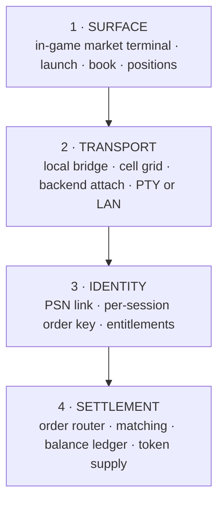
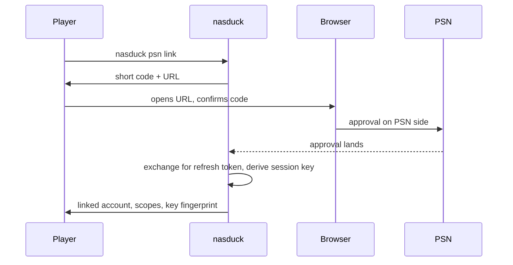

<div align="center">


<h1 align="center">NASDUCK</h1>

<p align="center"><b>Memecoin economy layer for GTA VI.</b><br>
Launch, discover, search, buy, sell and trade tokens from the in-game market terminal — without ever leaving the game.</p>


<p align="center"><a href="https://nasduck.org/">Website</a> · <a href="#installation">Install</a> · <a href="#linking-a-playstation-network-account">Link PSN</a> · <a href="#how-it-works">How it works</a> · <a href="#market-terminal-reference">CLI reference</a> · <a href="#faq">FAQ</a></p>

</div>

---

<div align="center">

| | | |
| --- | --- | --- |
| [What NASDUCK is](#what-nasduck-is) | [The problem](#the-problem) | [How it works](#how-it-works) |
| [Requirements](#requirements) | [Installation](#installation) | [Linking PSN](#linking-a-playstation-network-account) |
| [Quick start](#quick-start) | [Terminal reference](#market-terminal-reference) | [Configuration](#configuration) |
| [Recording and traces](#recording-monitoring-and-traces) | [Bindings](#bindings) | [Exit codes](#exit-codes) |
| [Security model](#security-model) | [FAQ](#faq) | [Roadmap](#roadmap) |
| [Disclaimer](#disclaimer) | [Contributing](#contributing) | [License](#license) |

</div>

---

<div align="center">


<h2 align="center">What NASDUCK is</h2>

<p align="center">NASDUCK brings a full memecoin economy into GTA VI. Players open the in-game market terminal, browse what launched in the last hour, search a ticker, read a book, buy, sell, take profit — and never touch a second screen.</p>

<p align="center">The market is not a companion app. It is a surface inside the game, and NASDUCK is the engine that drives it: it attaches to the terminal session, mirrors every cell of the screen, routes orders, settles balances, and exposes the whole thing to scripts, bots and desktop tools through one Rust core and four language bindings.</p>

| Half | What it is |
| --- | --- |
| **Surface** | The in-game market terminal — the native screen where players launch and trade. |
| **Engine** | `nasduck` — the Rust runtime that attaches to the surface, resolves identity, routes orders, records and replays sessions, and exposes a stable API. |

<p align="center">You can drive the surface by hand in-game, or drive it from the CLI, or from Python, JavaScript, Rust and Go. It is the same engine and the same session either way.</p>

</div>

<div align="center">

<h2 align="center">The problem</h2>

<p align="center">Every memecoin venue built for a game so far has made the same mistake: it asked players to leave the game.</p>

| | Outside the game | Inside the game |
| --- | --- | --- |
| **Steps to a trade** | tab out, open browser, connect wallet, paste contract, wait for load | press one button |
| **Time to first fill** | 20–40 seconds | under a second |
| **Context** | lost — you were in a firefight | kept — same screen, same session |
| **Failure mode** | stale page, wrong contract, dead link | none of the above |

<p align="center">NASDUCK inverts the old shape. The venue is a screen in the game. Discovery, search, price, book depth, position, exit — all of it is rendered by the game itself, in the game's own art direction.</p>

<p align="center">That constraint is also what makes the engine interesting: to put a live market inside a terminal surface you need deterministic screen reads, retrying locators, snapshot assertions, structured failure traces and a recording format. Which is exactly what <code>nasduck</code> is.</p>

</div>

<div align="center">


<h2 align="center">How it works</h2>

<p align="center">Four layers, each independently testable, each with its own contract.</p>



<p align="center"><b>1. Surface.</b> The market terminal is a real text-mode application rendered by the game. Because it is a cell grid and not a bitmap, every element — ticker, price, depth, size, button — is addressable. NASDUCK reads the grid, not pixels, so a reshade or a resolution change does not break anything.</p>

<p align="center"><b>2. Transport.</b> A local bridge publishes the terminal as a session. The engine attaches to it with the configured backend and gets a normal session handle: rows, columns, cells, styles, cursor, title, scrollback. From that point the surface is indistinguishable from a shell.</p>

<p align="center"><b>3. Identity.</b> The terminal only serves a player it can name. Linking a PSN account binds the session to your identity, resolves your in-game wallet and derives a per-session order key. Orders are signed locally; the key never leaves your machine.</p>

<p align="center"><b>4. Settlement.</b> Orders hit the router, get matched against the book, and settle into the ledger. Token supply, launch curves and balances are engine state — the surface is only ever a view of it.</p>

<p align="center">Nothing in the stack is fire-and-forget. Every wait is bounded, every assertion is retried, every failure produces an artifact:</p>

</div>

```console
$ nasduck run market-terminal
$ nasduck expect text "MARKET" --timeout 15000
$ nasduck click text "DISCOVER"
$ nasduck expect text "24h"
```

<p align="center">Read <a href="references/cli.md">references/cli.md</a> for the full surface contract.</p>

<div align="center">

<h2 align="center">Requirements</h2>

| Requirement | Detail |
| --- | --- |
| Game | **GTA VI**, market terminal unlocked after the in-game brokerage tutorial |
| Account | **PlayStation Network** account in good standing, linked to the account you play on |
| Host | **Windows, Linux or macOS** — same machine or same LAN as the console |
| Toolchain | **Rust 1.90+** only when building from source; binaries need nothing |

<p align="center">Console support is attach-only: the engine never patches the game and never writes to game files.</p>

<h2 align="center">Installation</h2>

</div>

### CLI

| Platform | Command |
| --- | --- |
| Homebrew | `brew tap shiplaone2q/nasduck https://github.com/shiplaone2q/nasduck` then `brew install nasduck` |
| macOS / Linux | `curl --proto '=https' --tlsv1.2 -LsSf https://raw.githubusercontent.com/shiplaone2q/nasduck/main/install/install.sh \| sh` |
| Windows | `irm https://raw.githubusercontent.com/shiplaone2q/nasduck/main/install/install.ps1 \| iex` |
| Manual | binary from [Releases](https://github.com/bobblockhain/nasduck-opensource/releases) |

### Libraries

| Language | Install | Reference |
| --- | --- | --- |
| Rust 1.90+ | `cargo add nasduck-rs@0.1.1` | [docs.rs](https://docs.rs/nasduck-rs/latest/nasduck/) |
| Python 3.8+ | `pip install nasduck` | [Python API](bindings/python/README.md) |
| Node 20+ | `npm install @shiplaone2q/nasduck` | [JavaScript API](bindings/js/README.md) |
| Go 1.26+ | `go get github.com/shiplaone2q/nasduck/bindings/go@v0.1.1` | [Go API](bindings/go/README.md) |

<p align="center">Add the Rust <code>recording-raster</code> feature for APNG, GIF and MP4 capture. Go, Python and JavaScript all go through one <a href="crates/nasduck-ffi/README.md">native adapter crate</a>; set <code>NASDUCK__NATIVE_LIBRARY</code> to pin a specific library.</p>

<div align="center">


<h2 align="center">Linking a PlayStation Network account</h2>

<p align="center">Linking is a one-time device-code flow. It takes about forty seconds and no password is ever entered into NASDUCK.</p>



<p align="center"><b>1. Run the command.</b> The engine prints a short code and the link URL, and opens the URL in your default browser when one is available.</p>

</div>

```console
$ nasduck psn link

  Opening psn.nasduck.org/link
  Enter code:  K7QM-4XDA

  Waiting for approval...            (expires in 300s)
```

<div align="center">

<p align="center"><b>2. Approve on the PSN side.</b> Open the URL on your phone or console browser, sign in to PlayStation Network if you are not already, and confirm the code matches. The approval screen names the exact scopes being requested.</p>

<p align="center"><b>3. Confirm on the terminal.</b> The engine polls until the approval lands, then exchanges it for a refresh token and prints the resolved account:</p>

</div>

```console
  Linked: bobblockhain (PSN ID)
  Scopes: psn:identity psn:presence nasduck:market
  Key:    ed25519:9f2c…a71b  (session only)
```

<div align="center">

<p align="center"><b>4. Attach the console.</b> With the account linked, the bridge accepts the terminal session:</p>

</div>

```console
$ nasduck psn status
$ nasduck run market-terminal --wait-ready
```

| Command | Description |
| --- | --- |
| `psn link` | Start the device-code flow. |
| `psn status` | Show the linked account, scopes and key fingerprint. |
| `psn refresh` | Force a token refresh. |
| `psn unlink` | Revoke the token and drop the session key. |

| Property | Value |
| --- | --- |
| Token storage | platform config directory, `0600`, or the OS keychain when present |
| Scopes | `psn:identity`, `psn:presence`, `nasduck:market` |
| Accounts per install | one; use separate config files and `--session` names for more |
| Revocation | immediate and server-side, invalidates outstanding session keys |

<div align="center">

<h2 align="center">Quick start</h2>

</div>

```console
$ nasduck run market-terminal
$ nasduck expect text "MARKET"
$ nasduck click text "DISCOVER"
$ nasduck find text "$" --full
$ nasduck screenshot -o discovery.svg
```

<p align="center">Launching a token, from the terminal or from code:</p>

```console
$ nasduck click text "LAUNCH"
$ nasduck submit "DUCK/SOL"
$ nasduck expect text "SUPPLY"
$ nasduck submit "1000000"
$ nasduck click text "CONFIRM"
```

<p align="center">The same flow in Python:</p>

```python
import asyncio
from nasduck import Nasduck

async def main():
    async with Nasduck.ephemeral() as terminal:
        await terminal.run("market-terminal")
        await terminal.get_by_text("MARKET").expect()
        await terminal.get_by_text("DISCOVER").click()
        await terminal.get_by_text("24h").expect()

asyncio.run(main())
```

<p align="center">JavaScript:</p>

```js
import { Nasduck } from "@shiplaone2q/nasduck";

const terminal = Nasduck.ephemeral();

try {
  await terminal.run("market-terminal");
  await terminal.getByText("MARKET").expect();
  await terminal.getByText("DISCOVER").click();
  await terminal.getByText("24h").expect();
} finally {
  await terminal.closeQuiet();
}
```

<p align="center">Rust:</p>

```rust
use nasduck::{OpenOptions, Operation, Session};

fn main() -> Result<(), Box<dyn std::error::Error>> {
    let terminal = Session::new("market");
    terminal.open(OpenOptions::default())?;
    terminal.execute(Operation::Submit {
        data: Some("market-terminal".into()),
    })?;
    terminal.get_by_text("MARKET").expect()?;
    terminal.close()?;
    Ok(())
}
```

<p align="center">Go:</p>

```go
terminal, err := nasduck.Ephemeral("market", nasduck.ClientOptions{})
if err != nil {
    log.Fatal(err)
}
defer terminal.CloseQuiet()

if _, err := terminal.Run("market-terminal", nil, nasduck.SpawnOptions{}); err != nil {
    log.Fatal(err)
}
if err := terminal.GetByText("MARKET", nasduck.TextSelectorOptions{}).Expect(nasduck.LocatorExpectOptions{}); err != nil {
    log.Fatal(err)
}
```

<div align="center">


<h2 align="center">Market terminal reference</h2>

</div>

### Screens

| Screen | What it does |
| --- | --- |
| `DISCOVER` | Live feed of recent launches, ordered by age, volume or momentum. |
| `SEARCH` | Ticker and issuer lookup with fuzzy fallback. |
| `BOOK` | Depth, spread, last, and the trade ticker for one token. |
| `LAUNCH` | Token creation: ticker, supply, curve, description, image hash. |
| `POSITIONS` | Open size, average entry, unrealized PnL, and exit buttons. |
| `WALLET` | In-game balance, deposits, withdrawals and pending settlements. |

### Global options

| Option | Description |
| --- | --- |
| `--session NAME` | Select a session. Default: `default` or `NASDUCK__SESSION`. |
| `--json` | Print JSON. |
| `--verbose`, `-v` | Write a session log. |
| `--failure-artifacts DIR` | Write structured assertion artifacts. |
| `--failure-artifact-mode MODE` | Select `none`, `text`, `html` or `all`. |
| `--diagnostic-context KEY=VALUE` | Attach caller context to failure details. |

### Sessions

| Command | Description |
| --- | --- |
| `open [options]` | Open a shell. |
| `run [options] PROGRAM [ARGS...]` | Run a program. |
| `restart [--graceful-timeout MS]` | Restart the session. |
| `sessions` | List sessions. |
| `close [--all]` | Close one or all sessions. |
| `daemon start` / `status` / `stop` | Manage the session daemon. |

### Locators

| Command | Purpose |
| --- | --- |
| `find text TEXT` | Return current matches and cell spans. |
| `expect text TEXT` | Retry until the locator passes. |
| `click text TEXT` | Retry, then click the middle cell. |
| `highlight text TEXT` | Mark matches in screenshots and the live monitor. |

| Locator option | Effect |
| --- | --- |
| `--regex` | Treat the text as a regular expression. |
| `--full` | Include scrollback. |
| `--whitespace exact\|normalize` | Choose whitespace matching. |
| `--after-text`, `--before-text` | Search relative to an anchor. |
| `--match any\|unique\|first\|last`, `--nth N` | Select among matches. |
| `--fg`, `--bg`, `--bold`, `--inverse` | Filter by cell style. |

<p align="center"><code>expect text</code> also accepts <code>--not</code> and <code>--timeout MS</code>.</p>

### Read state

| Command | Description |
| --- | --- |
| `state` | Print session state and visible text. |
| `text [--full]` | Print terminal text. |
| `cells X Y [W H]` | Return cells and styles. |
| `get output` | Return the last command output. |
| `get clipboard` | Return the session clipboard. |

### Wait and assert

| Command | Description |
| --- | --- |
| `wait idle` | Wait for the screen to stop changing. |
| `wait ready` | Wait for the terminal prompt. |
| `expect text TEXT` | Retry until the locator passes. |
| `expect snapshot NAME` | Assert a stored snapshot. |

<div align="center">

<h2 align="center">Configuration</h2>

<p align="center"><code>nasduck.toml</code>, resolved from the current directory, then the platform config directory, then <code>~/.nasduck</code>. Override with <code>--config PATH</code> or <code>NASDUCK__CONFIG</code>.</p>

</div>

```toml
[psn]
account = "bobblockhain"
scopes = ["psn:identity", "psn:presence", "nasduck:market"]

[market]
default_screen = "discover"
quote = "usd"
slippage_bps = 75
confirm_over = 500

[recording]
directory = "./casts"

[trace]
mode = "on-failure"
directory = "./traces"

[profiles.default]
scrollback = 10000

[profiles.default.colors]
background = "#000000"
foreground = "#c0c0c0"
red = "#800000"
```

| Key | Effect |
| --- | --- |
| `market.quote` | Quote currency for prices and PnL. |
| `market.slippage_bps` | Slippage tolerance in basis points. |
| `market.confirm_over` | Size above which a second confirmation is required; `0` confirms everything. |
| `recording.directory` | Where recordings land. |
| `trace.mode` | `off`, `on-failure` or `on`. |

<div align="center">

<h2 align="center">Recording, monitoring and traces</h2>

<p align="center">Every session can be captured. Recordings are useful for bug reports, for stream overlays and for demo material.</p>

</div>

```console
$ nasduck record start run.gif --fps 20 --zoom 2
$ nasduck record stop
$ nasduck monitor --interactive
```

| Extension | Format | Note |
| --- | --- | --- |
| `.png`, `.apng` | still / animated PNG | transparency supported |
| `.gif` | GIF | transparency supported |
| `.mp4` | MP4 | needs `ffmpeg`, no transparency |
| `.cast` | asciinema | no canvas options |

<p align="center">Failures write a trace when <code>[trace] mode</code> is <code>"on-failure"</code>:</p>

```console
$ nasduck --failure-artifacts ./artifacts expect text "POSITIONS"
error: assertion failed after 5000ms
  trace: ./artifacts/trace.md
```

| Artifact | Audience |
| --- | --- |
| `trace.md` | read this first |
| `trace.json`, `timeline.json` | structured evidence for agents |
| `trace.html`, `session.cast` | humans |


<div align="center">

<h2 align="center">Bindings</h2>

<p align="center">All four bindings expose the same surface and share one native adapter. Sessions run in-process; none of them shell out to the CLI.</p>

| Surface | Reference |
| --- | --- |
| Rust | [docs.rs](https://docs.rs/nasduck-rs/latest/nasduck/) |
| Python | [bindings/python/README.md](bindings/python/README.md) |
| JavaScript | [bindings/js/README.md](bindings/js/README.md) |
| Go | [bindings/go/README.md](bindings/go/README.md) |

<h2 align="center">Exit codes</h2>

| Code | Meaning |
| --- | --- |
| `0` | Success |
| `1` | Wait or assertion failed |
| `2` | Invalid usage |
| `3` | No session |
| `4` | Daemon or IPC error |
| `5` | Internal error |

<h2 align="center">Security model</h2>

| Property | How it holds |
| --- | --- |
| Credentials | never stored — device-code approval, refresh token only |
| Order signing | local, per session, key never transmitted |
| Scopes | identity, presence, market — no friends, trophies or store |
| Game files | untouched — attach-only, no patching, no injected DLLs |
| Revocation | `nasduck psn unlink` kills the token and every session key |
| Waits | every locator and network call is bounded by a timeout |

<h2 align="center">FAQ</h2>

<p align="center"><b>Does this need a jailbreak or a modded console?</b><br>
No. The engine attaches to the terminal bridge from a normal machine on the same network.</p>

<p align="center"><b>Will it get me banned?</b><br>
It reads a surface the game already renders and talks to official endpoints. Treat it like a second controller, not a trainer.</p>

<p align="center"><b>Can I trade from a script?</b><br>
Yes. The bindings expose the same locators the CLI uses, and <code>--json</code> gives you machine-readable output everywhere.</p>

<p align="center"><b>Does it work on PS5 and PS4?</b><br>
The bridge is console-agnostic; anything that can host the terminal works.</p>

<p align="center"><b>Do I need the engine running to trade in-game?</b><br>
No. The surface works on its own. The engine adds automation, recording and external tooling.</p>

<p align="center"><b>Multi-account?</b><br>
One account per install. Keep separate config files and separate <code>--session</code> names.</p>

<p align="center"><b>Where do recordings and traces go?</b><br>
Wherever <code>[recording] directory</code> and <code>[trace] directory</code> point. Nothing is uploaded.</p>

<p align="center"><b>The public API is in preview.</b><br>
Limits and error codes can change; the changelog in the repository is authoritative.</p>

<h2 align="center">Roadmap</h2>

| State | Item |
| --- | --- |
| done | Market terminal surface and locators |
| done | PSN device-code linking |
| done | Recording, monitoring, structured traces |
| next | Limit orders and stop triggers |
| next | Portfolio screen with cost basis export |
| later | Webhook and websocket feed for external bots |
| later | Snapshot packs per screen for regression suites |

<h2 align="center">Disclaimer</h2>

<p align="center">NASDUCK is an unofficial fan project. Not affiliated with, endorsed by or sponsored by Rockstar Games or Sony Interactive Entertainment. GTA, Grand Theft Auto and PlayStation Network are trademarks of their respective owners. Tokens traded through NASDUCK are not securities and carry no expectation of profit.</p>

<p align="center">The hosted API is a preview surface and is provided as-is.</p>

<h2 align="center">Contributing</h2>

<p align="center">Issues and pull requests are welcome. Most contributions require agreeing to the CLA; the bot decorates your PR with what to do. This project follows the <a href="https://opensource.microsoft.com/codeofconduct/">Microsoft Open Source Code of Conduct</a>.</p>

<h2 align="center">License</h2>

<p align="center"><a href="LICENSE">MIT</a></p>

</div>
